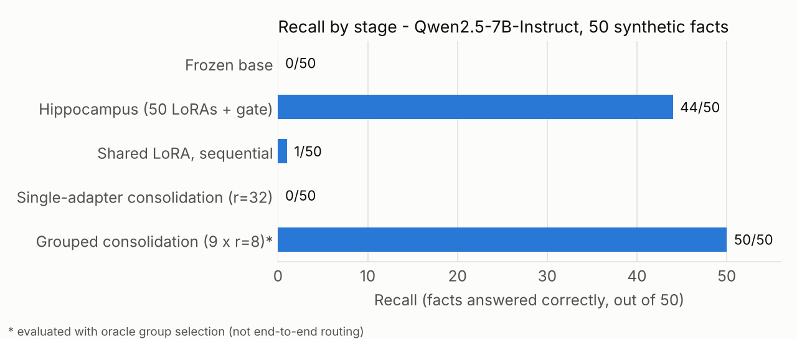
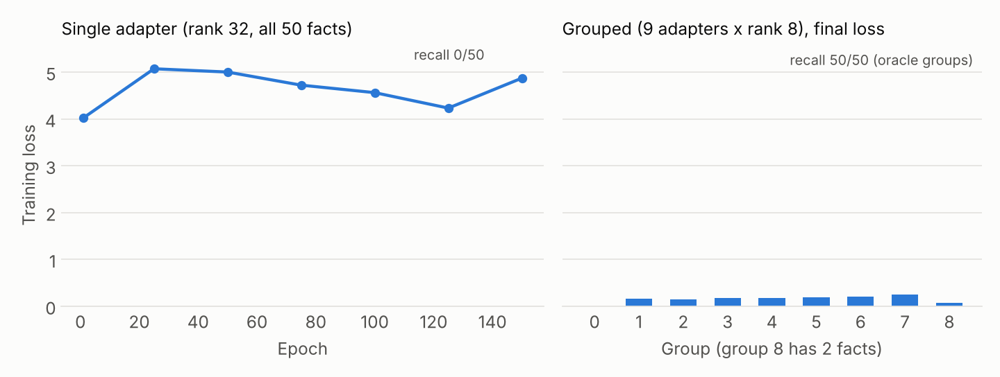
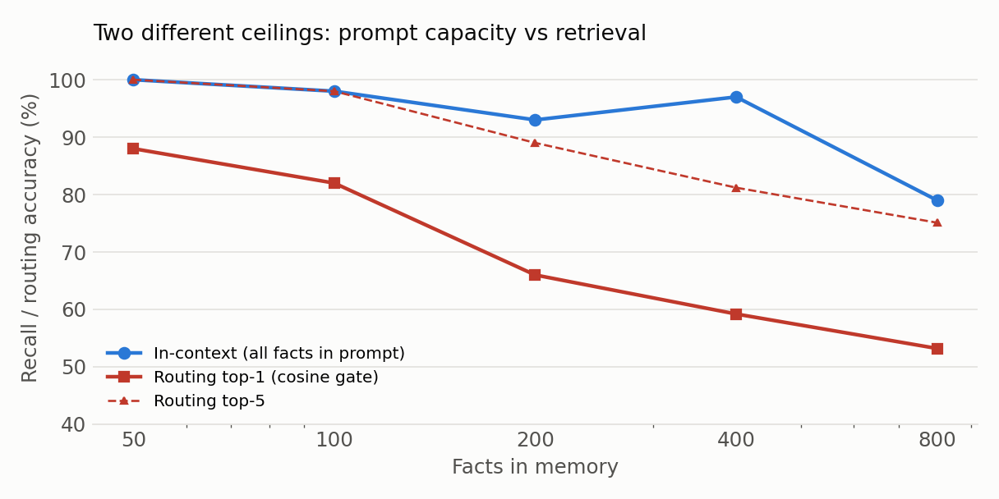
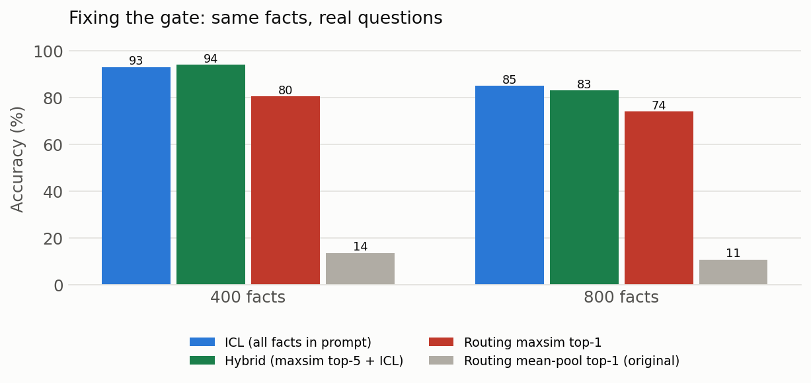

# CLS Dual-Memory: LoRA as Memory Slots

**English** | [简体中文](README.zh-CN.md)

> A small engineering probe of **Complementary Learning Systems** (CLS) on LoRA adapters: one adapter per episodic fact (hippocampus), replay-based consolidation into semantic adapters (cortex), embedding-cosine gating for routing.
>
> Qwen2.5-7B-Instruct, 4-bit QLoRA, 50 synthetic facts, RTX 4090 24 GB.

> **Status:** these are exploratory lab notes — not a paper, and not a complete validation of CLS theory. The numbers come from runs on 2026-10-08 ~ 10-10 and were **not re-run** when this repository was assembled. Read section 8 of the report for the evidence boundary. The full report is currently Chinese only ([`docs/report.md`](docs/report.md)).

---

## TL;DR

Five stages on 50 fabricated facts:

| Stage | Recall | Note |
|---|---|---|
| Frozen base model | 0/50 | Baseline: the base model knows none of these facts |
| Hippocampus (50 × rank-8 LoRA + cosine gate) | **44/50** | Routing accuracy 47/50; the 3 routing errors are identical across two runs |
| Shared LoRA, sequential learning | 1/50 | Catastrophic forgetting |
| Single-adapter consolidation (rank-32) | 0/50 | Loss oscillates around 4–5 and never converges |
| Grouped consolidation (9 × rank-8, 6 facts each) | **50/50** | Within-group recall; evaluation uses oracle group selection |





### In-context baseline (added 2026-10-22)

All 50 facts pasted into the system prompt (~700 tokens), no training, greedy decode, `src/baseline_icl.py`:

| Token budget | Recall | Wall clock | Note |
|---|---|---|---|
| 12 (same as the other stages) | 44/50 | 22 s | ties the hippocampus; all 6 misses are **truncation**, not wrong answers |
| 24 | **50/50** | 24 s | every fact answered correctly on the first try |

This is the comparison the original note was missing, and it is unkind to the LoRA stack: at 50 facts, simply putting the facts in the prompt is as accurate as the best consolidated configuration — no adapters, no training, no oracle routing. What weight-based memory could still buy is a constant context cost (0 prompt tokens instead of ~700) and graceful behaviour once the fact set outgrows the window, but at this scale that is an argument, not a measurement. The 12-token misses are worth reading: the model reproduces the fact's own wording and gets cut off mid-answer, which is exactly the kind of artefact a shared token budget produces when every stage is scored with the same decoder limit.
### Scaling both sides (same day)

The fair question is not "does in-context learning degrade" but "which side degrades first" — the prompt's capacity, or the cosine gate's ability to pick the right adapter out of N. Both were measured on the same facts: a deterministic synthetic set with six sentence templates and six answer types (`src/facts_scaled.py`, `make_facts_diverse`), so facts differ semantically rather than only by name.

| Facts | ICL recall | Prompt tokens | Routing top-1 | Routing top-5 | Gate margin |
|---|---|---|---|---|---|
| 50 | 50/50 · 100% | 954 | 88.0% | 100% | 0.013 |
| 100 | 98/100 · 98% | 1,890 | 82.0% | 98.0% | 0.009 |
| 200 | 93/100 · 93% | 3,880 | 66.0% | 89.0% | 0.007 |
| 400 | 97/100 · 97% | 7,865 | 59.2% | 81.2% | 0.006 |
| 800 | 79/100 · 79% | 15,807 | 53.2% | 75.1% | 0.005 |



Routing is measured on every fact (exact, no sampling); ICL uses 100 probes per size, so its numbers carry roughly ±5 percentage points at 400 and ±8 at 800.

**The two curves fail differently.** Prompt capacity holds up surprisingly well — 93–100% out to 400 facts, and still 79% at 800 — while the gate is already at 59% when the prompt is at 97%. Since each adapter only ever memorises its own sentence, storage is not the constraint: **retrieval is**. By 400 facts a per-fact LoRA memory is losing to simply pasting the facts into the prompt, and it loses before any training cost is counted.

> **A measurement trap worth recording.** The first version of this sweep used one uniform sentence template for every fact. On that set the gate scored **48% at N=50**, while the hand-written 50 facts score **94%** with identical code — the sentences were so similar that the mean-pooled embeddings differed by 0.005 cosine, and any retrieval collapses. The uniform set made the ICL curve look worse too (86% at 400 instead of 97%). Synthetic facts for retrieval experiments need sentence diversity, or they measure the template, not the method. That first run is kept in `results/icl_scaling.csv` and `results/logs/` for reference.

### Can the gate be fixed? Yes — and it changes the verdict

The 53% at the end of the last section is not a property of the architecture, it is a property of **mean-pooling a whole sentence into one vector**. Four scoring functions, same keys and queries, no training:

| Scoring | N=400 top-1 | N=400 top-5 | N=800 top-1 | N=800 top-5 |
|---|---|---|---|---|
| mean of last hidden state (original) | 59.2% | 81.2% | 53.2% | 75.1% |
| last token | 2.5% | 10.2% | 1.5% | 5.7% |
| per-dimension max | 89.7% | 98.7% | 86.5% | 97.7% |
| **late interaction (ColBERT-style MaxSim)** | **100%** | 100% | **100%** | 100% |

Late interaction never compresses the fact into one vector: every query token takes its best match across the fact's tokens. On prefix-style queries that is exact, so it reaches 100% — which also tells you these queries are too easy.

So the same experiment was rerun with **real questions** (`What passcode does the X protocol use?`), which do not share the fact's surface form:

| N | ICL (all facts in prompt) | Hybrid: MaxSim top-5 + ICL | MaxSim routing top-1 | mean-pool routing top-1 |
|---|---|---|---|---|
| 400 | 93% (7,865 tokens) | **94%** (≈110 tokens) | 80.5% | 13.5% |
| 800 | 85% (15,807 tokens) | 83% (≈110 tokens) | 74.0% | 10.7% |



Two things changed. First, the gate is fixable: 13% → 94% end-to-end at 400 facts. Second, the earlier conclusion was wrong in its diagnosis — the architecture was never losing because memory in weights does not scale, it was losing because I gave it a bad retriever. With late interaction it matches the in-context baseline at 400 facts and comes within 2 points at 800, while putting **~110 tokens** in the prompt instead of 7,865–15,807.

That token arithmetic is the honest selling point, not accuracy: same answers, ~1% of the context window, and the memory lives in weights rather than in every request.

**One more comparison, since it changes the recommendation.** The same paraphrase retrieval task with four retrievers:

| Retriever | N=400 top-1 | N=800 top-1 | Time per query |
|---|---|---|---|
| BM25 (lexical, no model) | 100% | 100% | ~0.1 ms |
| bge-small-en-v1.5 (33M params) | 98.8% | 97.4% | ~0.5 ms |
| Qwen2.5-7B, late interaction | 80.5% | 74.0% | ~2 ms |
| Qwen2.5-7B, mean-pooled (original) | 13.5% | 10.7% | ~2 ms |

A 33M-parameter retriever beats the 7B model's hidden states by 20+ points, and lexical BM25 is perfect. So the lesson is not "train a key encoder" — it is **do not use a frozen LM's pooled hidden state as a retriever**. Note the caveat: every question here contains the entity's name, which is exactly what BM25 exploits; on questions that paraphrase the entity away, lexical matching would collapse and a trained retriever would be needed.
**Caveats.** One model, one seed, synthetic facts with a single fact per entity; the paraphrase set is six templates, so the numbers are an upper bound on what real questions would give. Retrieval is again the bottleneck at 800 facts once you use the 7B's hidden states (74% top-1) — but a 33M retriever solves it, so the fix is to delegate retrieval, not to train bigger keys.

### Three takeaways

1. **The hippocampal side scales.** Per-fact LoRA plus cosine gating goes from 6 to 50 facts and still recalls 44/50 with 47/50 routing.
2. **Sequential learning forgets.** A single shared LoRA trained on 50 facts in sequence retains 1 — the same as 1/6 at the smaller scale.
3. **Single-adapter consolidation is the bottleneck of this recipe.** With batch=1, fixed order, rank-32 and 150 epochs, it reaches 0/50; split into 9 rank-8 adapters it returns to 50/50 within each group.
4. **The ceiling was the retriever, not the architecture.** Mean-pooling a sentence into one vector is what broke routing (53–59%); late interaction restores it (100% on prefix queries, 74–80% on real questions), and a top-5 shortlist fed back into the prompt matches the in-context baseline at 400 facts (94% vs 93%) and comes within 2 points at 800 (83% vs 85%) — with ~110 prompt tokens instead of 8k–16k.

### What these results do **not** support

- The grouped 50/50 is measured **after selecting the adapter by its known group** (oracle routing). End-to-end routing across the 9 semantic adapters from question content alone has not been tested.
- Single-adapter 0/50 is a failure of **this training recipe**; there is no rank sweep and no joint-training control (all 50 facts in one batch), so it is not evidence of a capacity limit.
- The in-context baseline was run on 2026-10-22, after the original numbers were produced, on a single seed and a single model; RAG and other retrieval baselines are still missing. The question the experiment asks is whether memory can be written into weights, not whether a given context can answer correctly — and the baseline now makes that distinction harder to argue in favour of the adapters.
- Single run, substring-match recall, and the original runs did not fix the random seed (scripts now default to `SEED=42` but were not re-run). See section 8 of the report.

## Repository layout

```
.
├── README.md
├── LICENSE                  # code: MIT
├── CITATION.cff
├── requirements.txt
├── setup.sh                 # AutoDL / Linux environment setup
├── docs/
│   ├── report.md            # full experiment report (Chinese)
│   └── LICENSE-CC-BY-4.0.md # report: CC BY 4.0
├── src/
│   ├── facts.py                 # shared synthetic facts (6 / 9 / 50)
│   ├── cls_demo.py              # 0.5B, CPU demo
│   ├── cls_demo_7b.py           # 7B, 6-fact full pipeline
│   ├── cls_demo_7b_50.py        # 7B, 50-fact full pipeline
│   ├── baseline_icl.py          # in-context baseline (provided, not yet run)
│   ├── cls_consolidation_test.py
│   ├── cls_generative_replay.py
│   ├── consolidate_grouped.py   # grouped consolidation (9 × rank-8)
│   └── diagnostics/             # 4-bit / 8-bit / consolidation diagnostics
└── results/
    ├── summary.csv              # five-stage results
    ├── loss_curves.csv          # consolidation losses
    ├── plot_results.py          # regenerates both figures from the CSVs
    └── fig_*.png
```

## Reproducing

### Hardware and environment

- NVIDIA RTX 4090 24 GB for the 50-fact runs (12 GB cards OOM); the 0.5B demo runs on CPU.
- Python 3.10+, `torch 2.5.1+cu124`, `transformers 4.57.6`, `peft 0.21.2`, `bitsandbytes 0.50.2`.
- `transformers` must be `<5.0`: 5.x depends on `torch.accelerator`, which is incompatible with torch 2.5.1.

```bash
bash setup.sh                                   # deps + Qwen2.5-7B-Instruct
export HF_ENDPOINT=https://hf-mirror.com        # mainline China
export HF_HOME=/root/autodl-tmp/hf              # AutoDL data disk, adjust as needed
```

### Running

```bash
python src/cls_demo.py             # 0.5B CPU demo
python src/cls_demo_7b.py          # 7B, 6 facts
python src/cls_demo_7b_50.py       # 7B, 50 facts (~57 min)
python src/consolidate_grouped.py  # grouped consolidation (~24 min)
python src/baseline_icl.py         # ICL baseline (provided, not yet run on the authors' hardware)
```

Facts live in `src/facts.py` (both 50-fact scripts share `FACTS_50`). The seed defaults to 42 and can be overridden with `SEED=123 python src/...`; bitsandbytes and some CUDA kernels are non-deterministic, so a fixed seed reduces but does not eliminate variance. `GROUP_SIZE`, `RANK`, `EPOCHS` and `LR_SLOW` are constants at the top of each script.

Key hyperparameters: hippocampus `rank=8, LR=1e-3, 100 steps/fact`; consolidation `LR_SLOW=5e-4, 150 epochs` (`1e-3` makes the adapters overwrite each other).

## Known pitfall: PEFT wrapper memory leak

`get_peft_model(base, ...)` returns a `LoraModel` that still references the base model through `self.model`. At the end of stage 1, `del model` alone leaves 19 GB allocated, so stage 2 OOMs when it loads a second base model. Fix:

```python
del model, base, keys, queries
```

and set `PYTORCH_CUDA_ALLOC_CONF=expandable_segments:True`.

## Related work

- **Complementary learning systems** — McClelland, McNaughton & O'Reilly (1995), *Psychological Review* 102(3); Kumaran, Hassabis & McClelland (2016), *Trends in Cognitive Sciences* 20(7). The two-system framing borrowed here.
- **Catastrophic forgetting** — French (1999), *TiCS* 3(4); Kirkpatrick et al. (2017), EWC, *PNAS* 114(13). Stage 3 reproduces the phenomenon in the adapter setting.
- **LoRA** — Hu et al. (2021), arXiv:2106.09685. The adapter used as a memory slot.
- **Adapter banks and mixtures** — Zadouri et al. (2023), MoLE, arXiv:2309.05444; Huang et al. (2024), LoraHub, arXiv:2307.13269. Closest prior art: many small adapters plus a router. The difference here is that adapters hold *episodic memories* rather than *skills*, and the consolidation stage is tested explicitly.
- **Retrieval and in-context memory** — Lewis et al. (2020), RAG, arXiv:2005.11401; Brown et al. (2020), arXiv:2005.14165; Packer et al. (2023), MemGPT, arXiv:2310.08560. The baselines this experiment has not yet run.

## Citation

See [`CITATION.cff`](CITATION.cff). Issues about experimental design or corrections are welcome.

## License

- Code: MIT ([`LICENSE`](LICENSE))
- Report and docs: CC BY 4.0 ([`docs/LICENSE-CC-BY-4.0.md`](docs/LICENSE-CC-BY-4.0.md))
- Model weights are not distributed here; Qwen2.5 is Apache-2.0.
