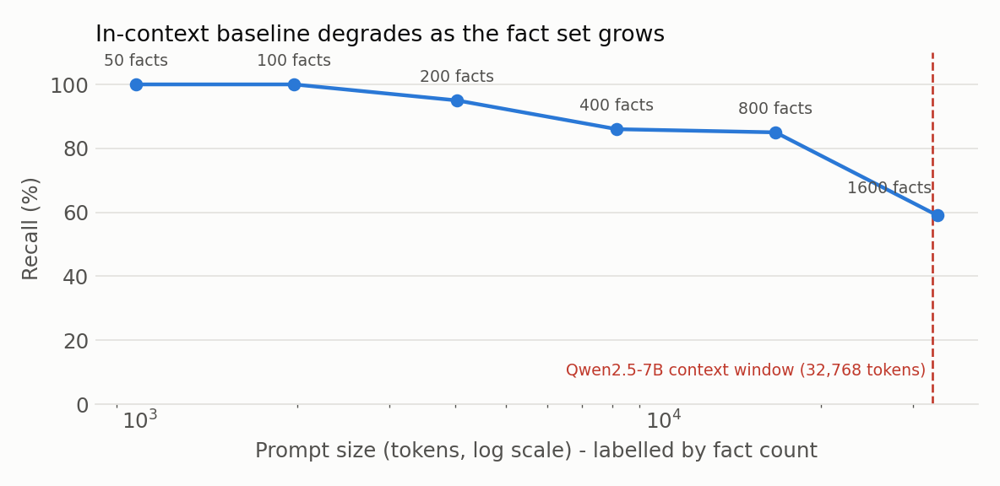

# CLS Dual-Memory: LoRA as Memory Slots

**English** | [简体中文](README.zh-CN.md)

> A small engineering probe of **Complementary Learning Systems** (CLS) on LoRA adapters: one adapter per episodic fact (hippocampus), replay-based consolidation into semantic adapters (cortex), embedding-cosine gating for routing.
>
> Qwen2.5-7B-Instruct, 4-bit QLoRA, 50 synthetic facts, RTX 4090 24 GB.

> **Status:** these are exploratory lab notes — not a paper, and not a complete validation of CLS theory. The numbers come from runs on 2026-10-08 ~ 10-10 and were **not re-run** when this repository was assembled. Read section 8 of the report for the evidence boundary. The full report is currently Chinese only ([`docs/report.md`](docs/report.md)).

---

## TL;DR

Five stages on 50 fabricated facts:

| Stage | Recall | Note |
|---|---|---|
| Frozen base model | 0/50 | Baseline: the base model knows none of these facts |
| Hippocampus (50 × rank-8 LoRA + cosine gate) | **44/50** | Routing accuracy 47/50; the 3 routing errors are identical across two runs |
| Shared LoRA, sequential learning | 1/50 | Catastrophic forgetting |
| Single-adapter consolidation (rank-32) | 0/50 | Loss oscillates around 4–5 and never converges |
| Grouped consolidation (9 × rank-8, 6 facts each) | **50/50** | Within-group recall; evaluation uses oracle group selection |


### In-context baseline (added 2026-10-22)

All 50 facts pasted into the system prompt (~700 tokens), no training, greedy decode, `src/baseline_icl.py`:

| Token budget | Recall | Wall clock | Note |
|---|---|---|---|
| 12 (same as the other stages) | 44/50 | 22 s | ties the hippocampus; all 6 misses are **truncation**, not wrong answers |
| 24 | **50/50** | 24 s | every fact answered correctly on the first try |

This is the comparison the original note was missing, and it is unkind to the LoRA stack: at 50 facts, simply putting the facts in the prompt is as accurate as the best consolidated configuration — no adapters, no training, no oracle routing. What weight-based memory could still buy is a constant context cost (0 prompt tokens instead of ~700) and graceful behaviour once the fact set outgrows the window, but at this scale that is an argument, not a measurement. The 12-token misses are worth reading: the model reproduces the fact's own wording and gets cut off mid-answer, which is exactly the kind of artefact a shared token budget produces when every stage is scored with the same decoder limit.
### Scaling the baseline (same day)

Same prompt format, 100 randomly chosen probes per size, 24-token budget, facts generated deterministically by `src/facts_scaled.py` (one uniform template, so the model has to locate the row by name — no semantic hints to lean on).

| Facts | Prompt tokens | Recall | Time |
|---|---|---|---|
| 50 | 981 | 50/50 | 32 s |
| 100 | 1,968 | 100/100 | 88 s |
| 200 | 4,031 | 95/100 | 141 s |
| 400 | 8,156 | 86/100 | 251 s |
| 800 | 16,404 | 85/100 | 486 s |
| 1,600 | 33,466 | 59/100 | 1003 s |



Two things happen. Recall holds at 100% to 100 facts, slides to 86% by 400, and then **plateaus at ~85% between 400 and 800** — a slope change, not a slow decay. At 1,600 facts the prompt itself is 33,466 tokens, past Qwen2.5's 32,768-token window: the context no longer fits, and recall falls to 59%.

So the baseline's limit is not "the model forgets" but "the window ends". That is the only regime where memory-in-weights has a clear argument — roughly 400 facts and up, or any setting where the facts cannot be pasted into the prompt at all. Nothing in this repository tests the LoRA stack in that regime yet; at 50 facts it simply ties.
### Three takeaways

1. **The hippocampal side scales.** Per-fact LoRA plus cosine gating goes from 6 to 50 facts and still recalls 44/50 with 47/50 routing.
2. **Sequential learning forgets.** A single shared LoRA trained on 50 facts in sequence retains 1 — the same as 1/6 at the smaller scale.
3. **Single-adapter consolidation is the bottleneck of this recipe.** With batch=1, fixed order, rank-32 and 150 epochs, it reaches 0/50; split into 9 rank-8 adapters it returns to 50/50 within each group.
4. **At 50 facts, in-context learning is a serious baseline.** It matches the hippocampus at an equal token budget and reaches 50/50 with a slightly larger one, for zero training. Any claim that this architecture is *necessary* has to be made at a scale or a context budget where the baseline stops fitting — and the scaling run shows that boundary sitting around 400–800 facts, with the hard wall at the 32k window.

### What these results do **not** support

- The grouped 50/50 is measured **after selecting the adapter by its known group** (oracle routing). End-to-end routing across the 9 semantic adapters from question content alone has not been tested.
- Single-adapter 0/50 is a failure of **this training recipe**; there is no rank sweep and no joint-training control (all 50 facts in one batch), so it is not evidence of a capacity limit.
- The in-context baseline was run on 2026-10-22, after the original numbers were produced, on a single seed and a single model; RAG and other retrieval baselines are still missing. The question the experiment asks is whether memory can be written into weights, not whether a given context can answer correctly — and the baseline now makes that distinction harder to argue in favour of the adapters.
- Single run, substring-match recall, and the original runs did not fix the random seed (scripts now default to `SEED=42` but were not re-run). See section 8 of the report.

## Repository layout

```
.
├── README.md
├── LICENSE                  # code: MIT
├── CITATION.cff
├── requirements.txt
├── setup.sh                 # AutoDL / Linux environment setup
├── docs/
│   ├── report.md            # full experiment report (Chinese)
│   └── LICENSE-CC-BY-4.0.md # report: CC BY 4.0
├── src/
│   ├── facts.py                 # shared synthetic facts (6 / 9 / 50)
│   ├── cls_demo.py              # 0.5B, CPU demo
│   ├── cls_demo_7b.py           # 7B, 6-fact full pipeline
│   ├── cls_demo_7b_50.py        # 7B, 50-fact full pipeline
│   ├── baseline_icl.py          # in-context baseline (provided, not yet run)
│   ├── cls_consolidation_test.py
│   ├── cls_generative_replay.py
│   ├── consolidate_grouped.py   # grouped consolidation (9 × rank-8)
│   └── diagnostics/             # 4-bit / 8-bit / consolidation diagnostics
└── results/
    ├── summary.csv              # five-stage results
    ├── loss_curves.csv          # consolidation losses
    ├── plot_results.py          # regenerates both figures from the CSVs
    └── fig_*.png
```

## Reproducing

### Hardware and environment

- NVIDIA RTX 4090 24 GB for the 50-fact runs (12 GB cards OOM); the 0.5B demo runs on CPU.
- Python 3.10+, `torch 2.5.1+cu124`, `transformers 4.57.6`, `peft 0.21.2`, `bitsandbytes 0.50.2`.
- `transformers` must be `<5.0`: 5.x depends on `torch.accelerator`, which is incompatible with torch 2.5.1.

```bash
bash setup.sh                                   # deps + Qwen2.5-7B-Instruct
export HF_ENDPOINT=https://hf-mirror.com        # mainline China
export HF_HOME=/root/autodl-tmp/hf              # AutoDL data disk, adjust as needed
```

### Running

```bash
python src/cls_demo.py             # 0.5B CPU demo
python src/cls_demo_7b.py          # 7B, 6 facts
python src/cls_demo_7b_50.py       # 7B, 50 facts (~57 min)
python src/consolidate_grouped.py  # grouped consolidation (~24 min)
python src/baseline_icl.py         # ICL baseline (provided, not yet run on the authors' hardware)
```

Facts live in `src/facts.py` (both 50-fact scripts share `FACTS_50`). The seed defaults to 42 and can be overridden with `SEED=123 python src/...`; bitsandbytes and some CUDA kernels are non-deterministic, so a fixed seed reduces but does not eliminate variance. `GROUP_SIZE`, `RANK`, `EPOCHS` and `LR_SLOW` are constants at the top of each script.

Key hyperparameters: hippocampus `rank=8, LR=1e-3, 100 steps/fact`; consolidation `LR_SLOW=5e-4, 150 epochs` (`1e-3` makes the adapters overwrite each other).

## Known pitfall: PEFT wrapper memory leak

`get_peft_model(base, ...)` returns a `LoraModel` that still references the base model through `self.model`. At the end of stage 1, `del model` alone leaves 19 GB allocated, so stage 2 OOMs when it loads a second base model. Fix:

```python
del model, base, keys, queries
```

and set `PYTORCH_CUDA_ALLOC_CONF=expandable_segments:True`.

## Related work

- **Complementary learning systems** — McClelland, McNaughton & O'Reilly (1995), *Psychological Review* 102(3); Kumaran, Hassabis & McClelland (2016), *Trends in Cognitive Sciences* 20(7). The two-system framing borrowed here.
- **Catastrophic forgetting** — French (1999), *TiCS* 3(4); Kirkpatrick et al. (2017), EWC, *PNAS* 114(13). Stage 3 reproduces the phenomenon in the adapter setting.
- **LoRA** — Hu et al. (2021), arXiv:2106.09685. The adapter used as a memory slot.
- **Adapter banks and mixtures** — Zadouri et al. (2023), MoLE, arXiv:2309.05444; Huang et al. (2024), LoraHub, arXiv:2307.13269. Closest prior art: many small adapters plus a router. The difference here is that adapters hold *episodic memories* rather than *skills*, and the consolidation stage is tested explicitly.
- **Retrieval and in-context memory** — Lewis et al. (2020), RAG, arXiv:2005.11401; Brown et al. (2020), arXiv:2005.14165; Packer et al. (2023), MemGPT, arXiv:2310.08560. The baselines this experiment has not yet run.

## Citation

See [`CITATION.cff`](CITATION.cff). Issues about experimental design or corrections are welcome.

## License

- Code: MIT ([`LICENSE`](LICENSE))
- Report and docs: CC BY 4.0 ([`docs/LICENSE-CC-BY-4.0.md`](docs/LICENSE-CC-BY-4.0.md))
- Model weights are not distributed here; Qwen2.5 is Apache-2.0.
